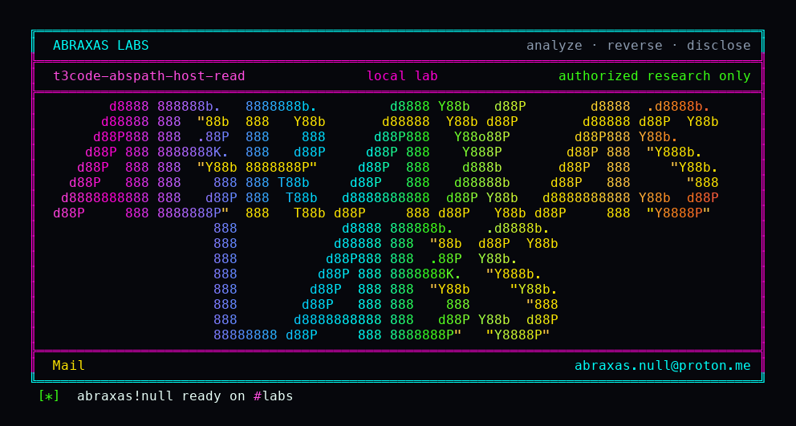

<p align="center">
  
</p>

# t3code-abspath-host-read

You pair a phone or a second machine to T3 Code so it can open project files. That same grant can open your SSH key. The file-read API takes an absolute path or a `~/` path and skips the workspace fence that writes still honor. Relative `../` stays blocked. A read-only MCP agent does not get this grant.

**Class:** Path leftover
**Reach:** Local (paired `filesystem:read`; also a paired phone or browser if the owner granted that scope)

**T3 Code** `61c3794c` - Ping

| | |
|---|---|
| ID | no CVE yet |
| Class | **Path leftover** |
| Reach | **Local** (paired client holding `filesystem:read`) |
| CWE | [CWE-22](https://cwe.mitre.org/data/definitions/22.html) / [CWE-73](https://cwe.mitre.org/data/definitions/73.html) |
| CVSS | **Medium: 6.5** `CVSS:3.1/AV:L/AC:L/PR:L/UI:N/S:C/C:H/I:N/A:N` |
| Product | [T3 Code](https://github.com/pingdotgg/t3code) |
| Affected | **61c3794c32b0eeebfac09add43e403618c65d2d7** (after v0.1.6) |
| Auth | paired or standard-grant session with `filesystem:read` |
| License | [GNU Affero GPL v3.0](LICENSE) |
| Lab | loopback Vitest against `WorkspaceFileSystem`; no production hosts |

## What an attacker can do

Needs a credential that already holds `filesystem:read`. Default pairing includes that scope, and also `terminal:operate`. Guest shares do not reach this RPC. MCP read-only is `orchestration:read` only.

| Privilege | Method / sink | Recon / integrity / availability | Lab-proven or inferred |
|---|---|---|---|
| Read a host file by absolute path | `WorkspaceFileSystem.readFile` / RPC `projectsReadFile` with `relativePath` set to an absolute path | Recon (host file) | Lab-proven. Witness `t3f01w8k2` returned |
| Read a host file by `~/` | same sink with `relativePath` `~/.lab-secret` under a lab `HOME` | Recon | Lab-proven. Same witness |
| Mint a signed asset URL for an absolute media path | `assetsCreateUrl` `media-file` | Recon | Inferred from source. Not this lab's oracle |
| Negative control: relative `../` | `readFile` with a path that walks out of the workspace | n/a | Lab-proven. `WorkspacePathOutsideRootError` |
| Negative control: absolute write | `writeFile` with the same absolute secret path | n/a | Lab-proven. refused, secret unchanged |
| Negative control: MCP read-only | `mcpClientScopes("read-only")` vs `projectsReadFile` | n/a | Lab-proven. denied |

**Stays closed on this leftover**

| Axis | Method / sink | Why it is closed |
|---|---|---|
| Integrity | Workspace writes by absolute path | `resolveWriteTarget` contains to the real root and refuses `.git` |
| Recon | Relative `../` read | `resolveRelativePathWithinRoot` |
| Recon | T3 `secretsDir` and `stateDir/*.sqlite` | `isServerInternalPath` |
| Recon | Guest share HTTP | Guest tokens never enter `SessionStore` |
| Recon | MCP read-only `/mcp` | no `filesystem:read` |
| Integrity | Unauthenticated loopback RPC | `EnvironmentAuthPolicy` is not `unsafe-no-auth` |

Product docs (`docs/internals/environment-auth.md`) describe `filesystem:read` as a host-read grant. The UI still sends workspace-relative paths. The server accepts input a legitimate client does not produce. Standard pairing also includes a shell.

## How I found it

I pinned pingdotgg/t3code `61c3794c`. `resolveReadTarget` expands `~/`, realpaths an absolute path, and returns it with no `isInsideRealRoot`. Writes do that check. Public issue #316 closed unconstrained `cwd` on writes only.

Wrong turns: treating MCP read-only as a caller of `projectsReadFile` (it is not); treating this as an unauthenticated leftover (it is a paired grant).

## Lab

```bash
python3 t3code-abspath-host-read-Abraxas-Labs.py
```

or:

```bash
cd lab
./run.sh
```

Clones [pingdotgg/t3code](https://github.com/pingdotgg/t3code) at `61c3794c` into `lab/src`, installs with pnpm, plants a witness under `lab-home/.lab-secret`, and runs Vitest. Loopback only. Node 26 and pnpm 12.

```text
IOC abs-read=1
IOC home-read=1
IOC rel-escape=0
IOC write-abs=refused
IOC mcp-readonly-filesystem=denied
IOC secret-unchanged=1
SUCCESS T3-F01-ABSPATH t3f01w8k2
```

## The fix

After `realpath`, require the target inside `realpath(cwd)` the way `resolveWriteTarget` already does. Call `knownWorkspaces.assertContains(input.cwd)` on read and metadata. Stop minting `media-file` URLs for absolute paths without a project. Widen `isServerInternalPath` to all of `stateDir`.

## References

- [github.com/pingdotgg/t3code](https://github.com/pingdotgg/t3code) `61c3794c32b0eeebfac09add43e403618c65d2d7`
- [`WorkspaceFileSystem.resolveReadTarget`](https://github.com/pingdotgg/t3code/blob/61c3794c32b0eeebfac09add43e403618c65d2d7/apps/server/src/workspace/WorkspaceFileSystem.ts)
- [CWE-22](https://cwe.mitre.org/data/definitions/22.html) · [CWE-73](https://cwe.mitre.org/data/definitions/73.html)

## License

GNU Affero GPL v3.0. See [LICENSE](LICENSE). Loopback lab only. No warranty.

Abraxas Labs
abraxas.null@proton.me

